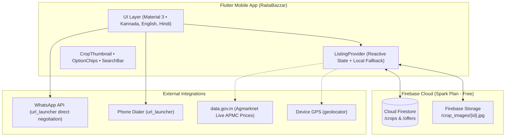

# 🌾 RaitaBazzar (ರೈತಬಜಾರ್) - Project Status Audit & Completion Roadmap

> **Mission:** Empower farmers to sell agricultural produce directly to buyers, retailers, and bulk consumers at transparent prices without intermediaries/middlemen.

---

## 📌 Executive Summary

* **Repository:** `raitabazzar`
* **Current Completion Status:** **~65% (Cloud-Connected Marketplace)**
* **Target Audience:** Indian Farmers (Primary: Karnataka / Regional with Kannada & Hindi support) and Buyers (Wholesalers, Retailers, Consumers).
* **Active Backend:** Firebase Cloud Firestore (real-time NoSQL) + Firebase Storage (crop photo CDN) with offline local cache fallback.
* **Build Health:** **0 errors, 0 warnings** (`flutter analyze` passing, all unit/widget tests passing).

---

## 🔍 Detailed Component Audit (Current State)

| Module / Component | Implementation Status | Technical Details |
| :--- | :--- | :--- |
| **Flutter & SDK** | ✅ **Healthy** | Flutter 3.47+ / Dart 3.13+ with Material 3 styling and agricultural green seed. |
| **Multilingual (i18n)** | ✅ **Complete (3 Languages)** | English (`app_en.arb`), Kannada (`app_kn.arb`), and Hindi (`app_hi.arb`) with instant top-bar switcher. |
| **Firebase Cloud Integration** | ✅ **Active** | `firebase_core: ^5.1.0`, `cloud_firestore: ^7.1.0`, `firebase_storage: ^14.0.1` initialized via `firebase_options.dart`. |
| **Cloud Firestore Service** | ✅ **Active** | `FirebaseService` handles real-time streams for `/crops` and `/offers`. |
| **Cloud Storage** | ✅ **Active** | Camera/gallery crop photos uploaded directly to Firebase Storage bucket with CDN URLs. |
| **Crop Thumbnail** | ✅ **Complete** | `CropThumbnail` dynamically renders network URLs, local files, or fallback eco icons. |
| **Farmer Dashboard** | ✅ **Complete** | 4-tab bottom navigation (`Dashboard`, `My Crops`, `Offers`, `Profile`), APMC ticker preview, weather card. |
| **Add Produce Screen** | ✅ **Complete** | Camera/gallery photo picker (`image_picker`), unit dropdown (Kg, Quintals, Bags), harvest date, location. |
| **Buyer Marketplace Feed** | ✅ **Complete** | Search bar with mic icon, category filters (Vegetables, Grains, Fruits, Pulses, Spices), produce cards. |
| **Direct Connect (No Middlemen)** | ✅ **Complete** | 1-tap **Phone Call** (`tel:`) and **WhatsApp** chat with pre-filled crop inquiry message via `url_launcher`. |
| **Interactive Bidding** | ✅ **Complete** | "Make Offer" bottom sheet allows buyers to propose custom price/qty; farmer can **Accept** or **Decline**. |
| **Phone Auth (SMS OTP)** | ⏸️ **Deferred by Choice** | Mock OTP flow in place. Real SMS OTP deferred until feature completion to avoid SMS fees. |
| **Live APMC Mandi Hub** | 🔜 **Next Up** | Government of India AGMARKNET API on `data.gov.in` mapped out for integration. |
| **GPS Distance Calculation** | 🔜 **Next Up** | `geolocator` installed, ready for radius slider and real-time km calculations. |

---

## 🏛️ System Architecture



---

## 💰 Cloud Cost & Spark Plan Summary

The project is running on the **Firebase Spark Plan (100% Free / ₹0)**:
* **Cloud Firestore:** 50,000 document reads, 20,000 writes, and 20,000 deletes **free every day**.
* **Firebase Storage:** 5 GB total storage, 1 GB/day download bandwidth, 20,000 uploads/day **free**.
* **Zero Financial Risk:** The Spark plan cannot incur charges because no credit card is linked. Quotas simply reset daily at midnight PST.

### 📱 Phone Authentication Cost Analysis (Why it is deferred)
* **Firebase Phone Auth in India:** Costs **$0.07 USD (~₹6.00 INR)** per OTP SMS beyond 10/day (requires Blaze plan).
* **Indian Domestic Gateways (MSG91 / Fast2SMS):** Cost **₹0.18 – ₹0.25 INR** per OTP (requires TRAI DLT business registration).
* **Decision:** Keep mock OTP during development, and plug in the chosen gateway right before production launch to prevent unnecessary costs.

---

## 🏛️ Live APMC Mandi Rates Architecture (AGMARKNET)

Real mandi auction data is sourced from the official Government of India Open Data platform:
* **API Portal:** [data.gov.in](https://data.gov.in)
* **Resource ID:** `9ef84268-d588-465a-a308-a864a43d0070`
* **Endpoint:**
  ```text
  https://api.data.gov.in/resource/9ef84268-d588-465a-a308-a864a43d0070?api-key=YOUR_API_KEY&format=json&filters[state]=Karnataka
  ```
* **Payload Fields:** `market`, `district`, `commodity`, `variety`, `min_price`, `max_price`, `modal_price` (₹/Quintal), `arrival_date`.
* **Caching Strategy:** Cache daily rates to Cloud Firestore once per day so the mobile app loads instantly without hammering government servers.

---

## 🗄️ Database Schema (Active in Firestore)

### Collection: `/crops`
```json
{
  "id": "auto_generated_id",
  "farmerId": "farmer_demo_1",
  "farmerName": "Basavaraj Gowda",
  "farmerPhone": "+919876543210",
  "cropName": "Sona Masoori Paddy",
  "category": "Grains & Cereals",
  "quantity": 40.0,
  "unit": "Quintal (100 kg)",
  "pricePerUnit": 2400.0,
  "location": "Mandya (28 km away)",
  "distanceKm": 28,
  "harvestDate": "Harvested 3 days ago",
  "description": "Premium quality Sona Masoori with low moisture.",
  "imageUrl": "https://firebasestorage.googleapis.com/.../crop.jpg",
  "status": "Active", // "Active" | "Sold Out"
  "createdAt": "2026-11-15T09:30:00Z"
}
```

### Collection: `/offers`
```json
{
  "id": "auto_generated_id",
  "listingId": "crop_doc_id",
  "buyerName": "Ramesh Wholesale Mart",
  "buyerPhone": "+919886011223",
  "buyerLocation": "Bengaluru (65 km)",
  "cropName": "Sona Masoori Paddy",
  "offeredPrice": 2350.0,
  "unit": "Quintal (100 kg)",
  "requestedQuantity": 40.0,
  "status": "Pending", // "Pending" | "Accepted" | "Declined"
  "createdAt": "2026-11-15T10:00:00Z"
}
```

---

## 🚀 Step-by-Step Completion Roadmap

### 🛠️ Phase 0: Project Stabilization & Technical Hygiene (COMPLETED ✅)
- [x] Fix `intl: ^0.20.3` dependency conflicts with Flutter 3.47 SDK.
- [x] Full localization setup: English, Kannada, and Hindi `.arb` files + `l10n.yaml`.
- [x] Clean up code base, remove unused skeletons (`auth_screen.dart`, `dummy.txt`).
- [x] Material 3 agricultural green theme provider.

### 🚜 Phase 1: Core Marketplace & Produce Engine (COMPLETED ✅)
- [x] **Add Produce Screen:** Live photo capture via camera/gallery (`image_picker`), crop tags, quantity in Quintals/Kg, price, harvest date, location.
- [x] **Farmer Dashboard:** Bottom navigation (`Dashboard`, `My Crops`, `Offers`, `Profile`), active produce list, weather card, Mandi preview.
- [x] **Buyer Marketplace Feed:** Category chips, search bar with mic, rich produce cards with bold pricing and farmer details.
- [x] **Middleman-Free Contact:** 1-tap **"Call"** (`tel:`) and **"WhatsApp"** with pre-filled negotiation text via `url_launcher`.
- [x] **Interactive Bidding:** Buyer "Make Offer" bottom sheet; Farmer "Accept" / "Decline" with live badge count.

### ☁️ Phase 2: Firebase Cloud Integration (COMPLETED ✅)
- [x] Link Firebase via `firebase_core: ^5.1.0` and `firebase_options.dart`.
- [x] Install `cloud_firestore: ^7.1.0` and `firebase_storage: ^14.0.1`.
- [x] Create `FirebaseService` with live Firestore streams and Storage upload.
- [x] Connect `ListingProvider` to Firestore with offline fallback support.
- [x] Build unified `CropThumbnail` component for network, local file, and asset images.

---

### 🔜 Phase 3: Market Intelligence & Location Proximity (NEXT IN QUEUE)
- [ ] **Live APMC Mandi Hub (`mandi_service.dart`):**
  - Connect to official `data.gov.in` AGMARKNET API.
  - Show daily market rates for major Karnataka APMCs (Mandya, Bengaluru, Mysuru, Kolar, Belagavi).
  - Add "Suggested Mandi Price" helper badge on the Add Crop form.
- [ ] **GPS Geolocation & Distance Filtering (`geolocator`):**
  - Auto-fetch device GPS on listing creation.
  - Calculate real-world driving distance in km on buyer cards.
  - Add buyer distance radius filter slider (e.g. 10 km, 25 km, 50 km, 100 km).

### 🤝 Phase 4: Deal Receipts & Value-Adds
- [ ] **Digital Deal Receipt Generator:**
  - Generate a shareable deal confirmation card upon offer acceptance.
  - 1-tap "Share Receipt on WhatsApp" for transaction record.
- [ ] **Vernacular Crop Search Dictionary:**
  - Bi-directional Kannada/Hindi/English crop name search (e.g., searching "ಟೊಮೇಟೊ" finds "Tomato").

### 📱 Phase 5: Final Authentication & Play Store Launch
- [ ] Plug in production Phone OTP authentication (Firebase Phone Auth or Supabase + MSG91).
- [ ] Beta field testing with 15–20 farmers in Karnataka.
- [ ] Google Play Store release.

---

## 📦 Current Dependencies (`pubspec.yaml`)

```yaml
dependencies:
  flutter:
    sdk: flutter
  flutter_localizations:
    sdk: flutter

  # UI, Theme & Icons
  cupertino_icons: ^1.0.8
  provider: ^6.1.5
  intl: ^0.20.3

  # Hardware & Actions
  image_picker: ^1.2.4
  url_launcher: ^6.3.3
  geolocator: ^10.1.0

  # Firebase Backend (Spark Plan)
  firebase_core: ^5.1.0
  cloud_firestore: ^7.1.0
  firebase_storage: ^14.0.1
```

---

## 🎯 Verification Command
To verify codebase health at any time:
```bash
flutter analyze  # Result: No issues found!
flutter test     # Result: All tests passed!
```
